### Hi, I'm Arshia

Full stack software engineer at [AltaML](https://www.altaml.com), building LLM-powered data and document systems with Python, FastAPI, Next.js and PostgreSQL on Azure and GCP.

I hold an M.Sc. in Physics from the University of Calgary. My thesis, [*Learning and Stabilizing Memories in Recurrent Spiking Neural Networks*](https://hdl.handle.net/1880/125338), studied how biologically plausible spiking networks learn new memories and what traces of old ones survive. Before that: a B.Sc. in Physics from Sharif University of Technology and a silver medal at the 2017 International Physics Olympiad.

[Website](https://arshiarazavi.github.io) · [LinkedIn](https://www.linkedin.com/in/arshia-razavi) · [Google Scholar](https://scholar.google.com/citations?user=L13TvcUAAAAJ) · [Email](mailto:razavi.arshia@gmail.com)
